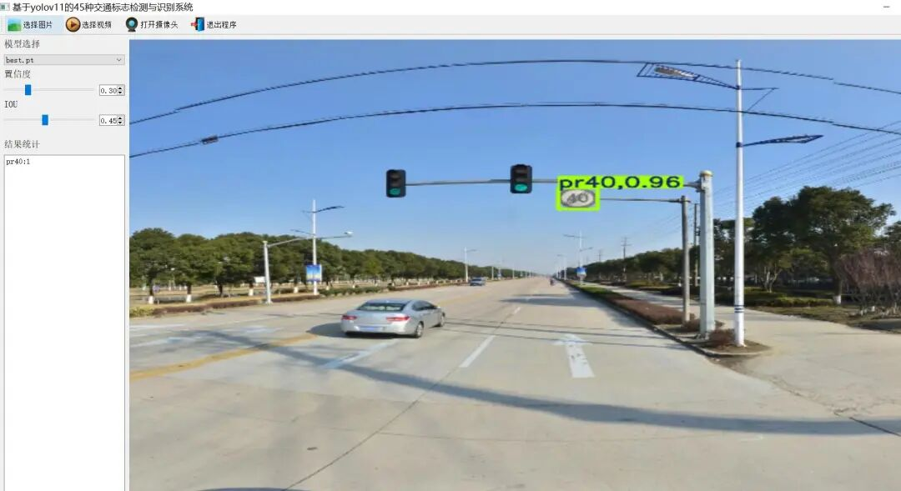
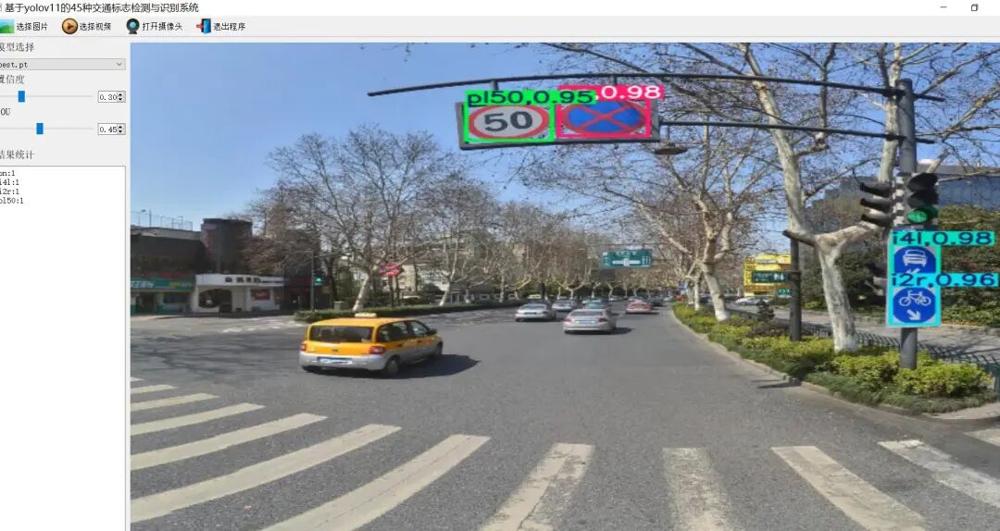
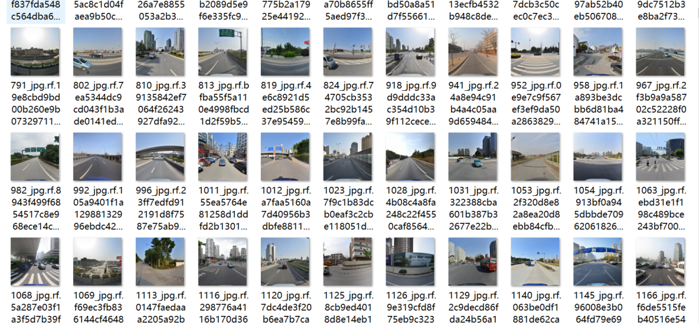

# 45 Traffic Sign Recognition System Based on Yolov11 with Python Source Code, PyTorch Model, Evaluation Indicator Curve, and High-quality GUI Interface

[Algorithm Introduction]The 45-type traffic sign detection and recognition system based on YOLOv11 is designed specifically for the field of intelligent transportation and autonomous driving, utilizing deep learning solutions.

[Algorithm Introduction]

The 45-class traffic sign detection and recognition system based on YOLOv11 is a deep learning solution specifically designed for the intelligent transportation and autonomous driving fields. This system leverages the latest advantages of the YOLOv11 object detection algorithm to achieve efficient and precise recognition of 45 common traffic signs, including speed limit signs, parking signs, and prohibited passage signs.

The core of the system adopts the YOLOv11 model, which significantly enhances feature extraction capabilities and spatial attention through optimization of C3k2 blocks, SPPF modules, and C2PSA attention mechanisms. This notably improves detection accuracy for small and overlapping targets in complex scenarios. At the data level, the system is trained on public datasets such as TT100K, combined with data augmentation techniques like rotation, scaling, and flipping to ensure generalization capability across various scenes and lighting conditions.

The system architecture consists of three main modules: image input, real-time camera detection, and video file reading; the detection and recognition module utilizes YOLOv11 to rapidly locate and classify traffic signs; the result output module draws detection boxes on the image and labels them with category information.

The system can be widely used in vehicle-mounted assisted driving. Traffic monitoring and intelligent navigation system. By improving the accuracy of road sign recognition, Effectively reduce the risk of traffic accidents. Promote the implementation of intelligent transportation technology.

[Effect Display]

Editor

Editor

[Training Dataset Introduction]
Dataset format: YOLO format (containing only jpg images and corresponding yolo format txt files, with training, validation, and test sets already divided)
Number of images (number of jpg files): 9720
Number of annotations (number of xml files): 9720
Number of annotations (number of txt files): 9720
Number of annotation categories: 45
Label category names (Note that the order of yolo format categories does not correspond to this, but rather follows the provided data.yaml category order): ["i2", "i2r", "i4", "i4l", "i5", "il60", "il80", "il100", "ip", "p3", "p5", "p6", "p10", "p11", "p12", "p13", "p19", "p23", "p26", "p27", "pg", "ph4", "ph4.5", "ph5", "pl5", "pl20", "pl30", "pl40", "pl50", "pl60", "pl70", "pl80"]"pl100","pl120","pm20","pm30","pm55","pn","pne","pr40","w13","w32","w55","w57","w59"]
Number of boxes per category:
i2 471
i2r 429
i4 812
i4l 335
i5 1734
il60 132
il80 488
il100 296
ip 354
p3 374
p5 1580
p6 189
p10 379
p11 128
p12 296
p13 839
p19 134
p23 173
p26 421
p27 116
pg 157
ph4 121
ph4.5 186
ph5 121
pl5 670
pl20 298
pl30 164
pl40 639
pl50 1409
pl60 537
pl70 1071
pl80 834
pl100 148
pl120 901
pm20 156
pm30 106
pm55 139
pn 3172
pne 2383
pr40 201
w13 130
w32 123
w55 179
w57 418
w59 231
Total number of boxes: 24,174
Labeling tool used: labelImg
Labeling rules: Draw a box around the category.
Important note: No specific instructions provided.
Special : This dataset does not guarantee the accuracy or precision of the trained models or weight files. The dataset is provided with accurate and reasonable annotations only.

Image Preview:

Editor

[Training Information]


Parameters


Value


Number of training set images


6793


Number of images in the validation set


1931


Training map


64.3%


Training Accuracy


68.4%


Training recall rate


58.5%


[Validation set accuracy statistics]


Class


Images


Instances


P


R


mAP50


mAP50-95


all


1931


4797


0.684


0.585


0.643


0.459


i2


87


87


0.72


0.649


0.756


0.472


i2r


91


91


0.781


0.681


0.754


0.513


i4


154


164


0.833


0.67


0.788


0.493


i4l


73


74


0.82


0.676


0.774


0.537


i5


325


346


0.91


0.761


0.879


0.558


il60


69


91


0.819


0.894


0.919


0.7


il80


53


59


0.707


0.859


0.872


0.663


il100


28


28


0.831


0.703


0.88


0.664


ip


60


70


0.731


0.543


0.65


0.318


p3


30


30


0.82


0.6


0.697


0.522


p5


76


79


0.765


0.646


0.703


0.523


p6


23


23


0.563


0.392


0.513


0.447


p10


69


71


0.579


0.577


0.574


0.44


p11


313


315


0.749


0.622


0.713


0.459


p12


36


36


0.489


0.389


0.331


0.255


p13


52


82


0.664


0.598


0.634


0.379


p19


24


24


0.539


0.487


0.508


0.409


p23


60


61


0.734


0.574


0.668


0.493


p26


163


172


0.685


0.616


0.692


0.499


p27


29


29


0.425


0.379


0.368


0.282


pg


29


29


0.954


0.621


0.756


0.523


ph4


22


23


0.67


0.529


0.584


0.454


ph4.5


31


35


0.694


0.713


0.693


0.542


ph5


21


24


0.439


0.208


0.294


0.198


pl5


75


110


0.657


0.473


0.533


0.336


pl20


31


33


0.598


0.0904


0.202


0.138


pl30


122


124


0.606


0.5


0.55


0.413


pl40


277


286


0.69


0.476


0.611


0.421


pl50


209


210


0.579


0.471


0.527


0.377


pl60


170


174


0.526


0.575


0.564


0.441


pl70


28


28


0.696


0.573


0.597


0.478


pl80


158


165


0.713


0.661


0.713


0.52


pl100


76


131


0.813


0.797


0.883


0.689


pl120


47


59


0.679


0.79


0.781


0.607


pm20


26


26


0.629


0.538


0.66


0.498


pm30


17


17


0.251


0.412


0.252


0.217


pm55


31


32


0.662


0.675


0.72


0.583


pn


603


633


0.901


0.736


0.829


0.526


pne


429


471


0.92


0.779


0.876


0.537


pr40


37


37


0.82


0.892


0.945


0.785


w13


27


27


0.455


0.333


0.354


0.242


w32


23


23


0.678


0.261


0.349


0.175


w55


43


43


0.531


0.512


0.513


0.364


w57


77


82


0.648


0.718


0.737


0.514


w59


43


43


0.803


0.663


0.742


0.455


[Test Environment]

windows10
anaconda3+python3.8
torch==2.3.1
ultralytics==8.3.120
onnxruntime==1.16.3

[Interface Design]

```
class Ui_MainWindow(QtWidgets.QMainWindow):
signal = QtCore.pyqtSignal(str, str)
def setupUi(self):
self.setObjectName("MainWindow")
self.resize(1280, 728)
self.centralwidget = QtWidgets.QWidget(self)
self.centralwidget.setObjectName("centralwidget")
self.weights_dir = './weights'
self.picture = QtWidgets.QLabel(self.centralwidget)
self.picture.setGeometry(QtCore.QRect(260, 10, 1010, 630))
self.picture.setStyleSheet("background:black")
self.picture.setObjectName("picture")
self.picture.setScaledContents(True)
self.label_2 = QtWidgets.QLabel(self.centralwidget)
self.label_2.setGeometry(QtCore.QRect(10, 10, 81, 21))
self.label_2.setObjectName("label_2")
self.cb_weights = QtWidgets.QComboBox(self.centralwidget)
self.cb_weights.setGeometry(QtCore.QRect(10, 40, 241, 21))
self.cb_weights.setObjectName("cb_weights")
self.cb_weights.currentIndexChanged.connect(self.cb_weights_changed)
self.label_3 = QtWidgets.QLabel(self.centralwidget)
self.label_3.setGeometry(QtCore.QRect(10, 70, 72, 21))
self.label_3.setObjectName("label_3")
self.hs_conf = QtWidgets.QSlider(self.centralwidget)
self.hs_conf.setGeometry(QtCore.QRect(10, 100, 181, 22))
self.hs_conf.setProperty("value", 25)
self.hs_conf.setOrientation(QtCore.Qt.Horizontal)
self.hs_conf.setObjectName("hs_conf")
self.hs_conf.valueChanged.connect(self.conf_change)
self.dsb_conf = QtWidgets.QDoubleSpinBox(self.centralwidget)
self.dsb_conf.setGeometry(QtCore.QRect(200, 100, 51, 22))
self.dsb_conf.setMaximum(1.0)
self.dsb_conf.setSingleStep(0.01)
self.dsb_conf.setProperty("value", 0.25)
self.dsb_conf.setObjectName("dsb_conf")
self.dsb_conf.valueChanged.connect(self.dsb_conf_change)
self.dsb_iou = QtWidgets.QDoubleSpinBox(self.centralwidget)
self.dsb_iou.setGeometry(QtCore.QRect(200, 160, 51, 22))
self.dsb_iou.setMaximum(1.0)
self.dsb_iou.setSingleStep(0.01)
self.dsb_iou.setProperty("value", 0.45)
self.dsb_iou.setObjectName("dsb_iou")
self.dsb_iou.valueChanged.connect(self.dsb_iou_change)
self.hs_iou = QtWidgets.QSlider(self.centralwidget)
self.hs_iou.setGeometry(QtCore.QRect(10, 160, 181, 22))
self.hs_iou.setProperty("value", 45)
self.hs_iou.setOrientation(QtCore.Qt.Horizontal)
self.hs_iou.setObjectName("hs_iou")
self.hs_iou.valueChanged.connect(self.iou_change)
self.label_4 = QtWidgets.QLabel(self.centralwidget)
self.label_4.setGeometry(QtCore.QRect(10, 130, 72, 21))
self.label_4.setObjectName("label_4")
self.label_5 = QtWidgets.QLabel(self.centralwidget)
self.label_5.setGeometry(QtCore.QRect(10, 210, 72, 21))
self.label_5.setObjectName("label_5")
self.le_res = QtWidgets.QTextEdit(self.centralwidget)
self.le_res.setGeometry(QtCore.QRect(10, 240, 241, 400))
self.le_res.setObjectName("le_res")
self.setCentralWidget(self.centralwidget)
self.menubar = QtWidgets.QMenuBar(self)
self.menubar.setGeometry(QtCore.QRect(0, 0, 1110, 30))
self.menubar.setObjectName("menubar")
self.setMenuBar(self.menubar)
self.statusbar = QtWidgets.QStatusBar(self)
self.statusbar.setObjectName("statusbar")
self.setStatusBar(self.statusbar)
self.toolBar = QtWidgets.QToolBar(self)
self.toolBar.setToolButtonStyle(QtCore.Qt.ToolButtonTextBesideIcon)
self.toolBar.setObjectName("toolBar")
self.addToolBar(QtCore.Qt.TopToolBarArea, self.toolBar)
self.actionopenpic = QtWidgets.QAction(self)
icon = QtGui.QIcon()
icon.addPixmap(QtGui.QPixmap(":/images/1.png"), QtGui.QIcon.Normal, QtGui.QIcon.Off)
self.actionopenpic.setIcon(icon)
self.actionopenpic.setObjectName("actionopenpic")
self.actionopenpic.triggered.connect(self.open_image)
self.action = QtWidgets.QAction(self)
icon1 = QtGui.QIcon()
icon1.addPixmap(QtGui.QPixmap(":/images/2.png"), QtGui.QIcon.Normal, QtGui.QIcon.Off)
self.action.setIcon(icon1)
self.action.setObjectName("action")
self.action.triggered.connect(self.open_video)
self.action_2 = QtWidgets.QAction(self)
icon2 = QtGui.QIcon()
icon2.addPixmap(QtGui.QPixmap(":/images/3.png"), QtGui.QIcon.Normal, QtGui.QIcon.Off)
self.action_2.setIcon(icon2)
self.action_2.setObjectName("action_2")
self.action_2.triggered.connect(self.open_camera)
self.actionexit = QtWidgets.QAction(self)
icon3 = QtGui.QIcon()
icon3.addPixmap(QtGui.QPixmap(":/images/4.png"), QtGui.QIcon.Normal, QtGui.QIcon.Off)
self.actionexit.setIcon(icon3)
self.actionexit.setObjectName("actionexit")
self.actionexit.triggered.connect(self.exit)
self.toolBar.addAction(self.actionopenpic)
self.toolBar.addAction(self.action)
self.toolBar.addAction(self.action_2)
self.toolBar.addAction(self.actionexit)
self.retranslateUi()
QtCore.QMetaObject.connectSlotsByName(self)
self.init_all()
```

The model can detect 45 categories.

```
names:
- i2
- i2r
- i4
- i4l
- i5
- il100
- il60
- il80
- ip
- p10
- p11
- p12
- p13
- p19
- p23
- p26
- p27
- p3
- p5
- p6
- pg
- ph4
- ph4.5
- ph5
- pl100
- pl120
- pl20
- pl30
- pl40
- pl5
- pl50
- pl60
- pl70
- pl80
- pm20
- pm30
- pm55
- pn
- pne
- pr40
- w13
- w32
- w55
- w57
- w59
nc: 45
test: ../test/images
train: ../train/images
val: ../valid/images

```

[Common Evaluation Parameters Introduction]

In the task of object detection, evaluating the performance of a model is crucial. The terms you mentioned are commonly used metrics for assessing the performance of a model. Here are detailed explanations of these terms:

1.

1. **Class**

:

-

-

This usually refers to the categories of objects that the model is designed to detect. For example, a model may be trained to detect different categories of objects such as vehicles, pedestrians, or animals.

-

1.

1. **Images**

:

-

-

Represents the number of images in the validation set. The validation set is a dataset used to evaluate model performance, separate from the training set to ensure fairness in evaluation results.

-

1.

1. **Instances**

:

-

-

The total number of target objects in all images. This includes the sum of all category objects, for example, if the validation set contains 100 images, each image has an average of 5 target objects, then Instances is 500.

-

1.

1. **P (Precision)**

:

-

-

Precision is the proportion of actual positive samples predicted by the model. The formula is: Precision = TP / (TP + FP), where TP represents true positives (True Positives) and FP represents false positives (False Positives).

-

1.

1. **R (Recall)**

:

-

-

Recall is the proportion of all true positives correctly predicted by the model. The formula is: Recall = TP / (TP + FN), where FN represents false negatives.

-

1.

1. **mAP50**

:

-

-

Mean Average Precision (mAP) at an IoU threshold of 0.5, where IoU is the metric used to measure the degree of overlap between predicted bounding boxes and ground truth bounding boxes. mAP is a comprehensive metric that considers both precision and recall when evaluating model performance across different recall levels. At an IoU of 0.5, if the overlap between the predicted bounding box and the ground truth bounding box reaches or exceeds 50%, it is considered correct.

-

1.

1. **mAP50-95**

:

-

-

This represents the average accuracy of the model across IoU values ranging from 0.5 to 0.95 (with a step of 0.05). This is a more stringent evaluation criterion, demanding higher overlap between predicted bounding boxes and ground truth boxes. In object detection tasks, higher IoU thresholds mean that models need to be more accurate in their target object localization. The computation of mAP50-95 takes into account multiple IoU thresholds ranging from lenient to strict, thus providing a more comprehensive assessment of the model's performance.

-

These indicators collectively form an important framework for evaluating the performance of target detection models. By comparing the performance of different models on these indicators, It can be determined which model may be more effective in practical applications.

[Usage Steps]

Usage Steps:
1. Install the YOLOv11 environment according to the official framework ultralytics installation tutorial, and install PyQt5.
2. After switching to the YOLOv11 environment you have installed, and switch to the source code directory, execute python main.py to start the interface, and perform the corresponding operations.

[Provided Files]

Python source code
YOLOv11n.pt model
Training map, P, R curves (in weights\results.png)
Test images (under test_img folder)

Please provide the training dataset, and you can find the address in mytxt.txt file.


## Payment

Here is a pay link on Stripe ( https://buy.stripe.com/3cs8yP7sY87d0vu9AB ). Please contact me lonlonago@foxmail.com after funding $89, and I will send you a complete data files , thank you!


